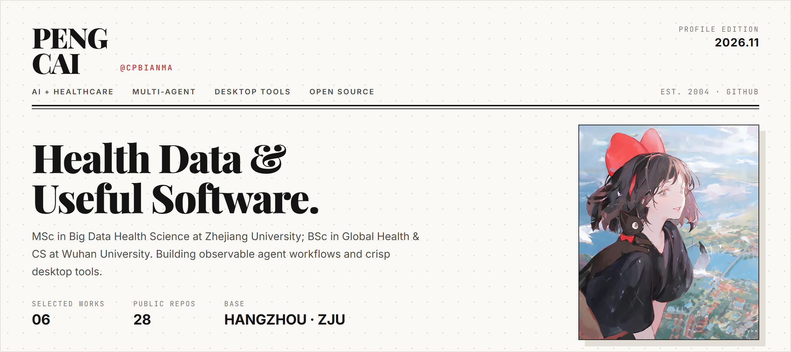
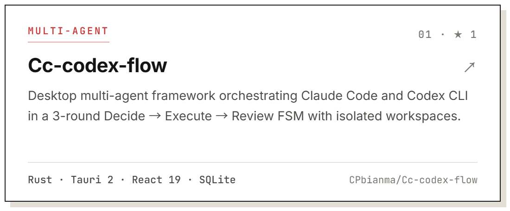
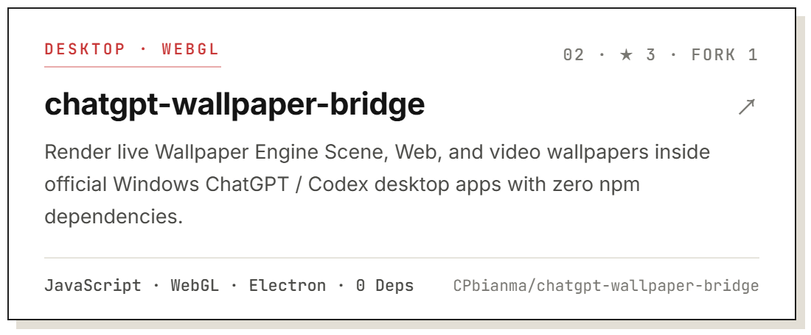
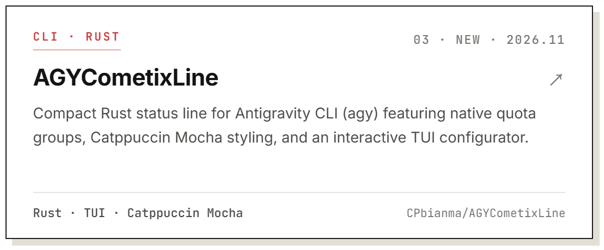
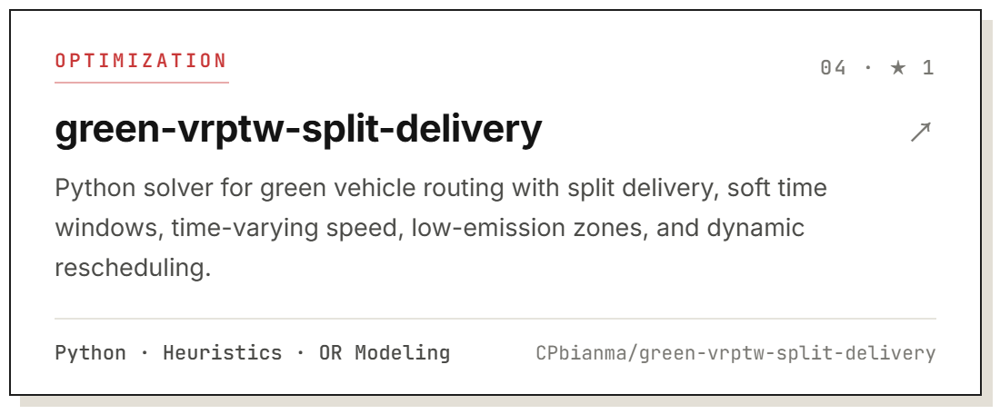
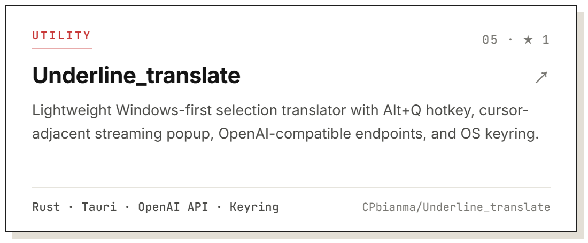
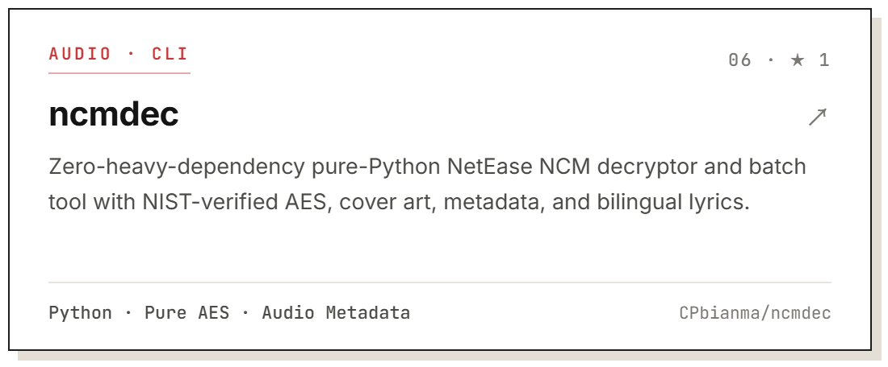
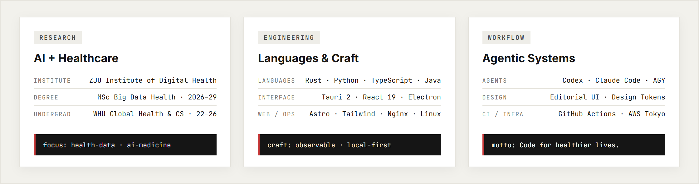

  <picture>
    <source media="(prefers-color-scheme: dark)" srcset="./assets/editorial/hero-en-dark.png" />
    <source media="(prefers-color-scheme: light)" srcset="./assets/editorial/hero-en-light.png" />
    
  </picture>

  <a href="https://github.com/CPbianma/CPbianma/blob/main/README.md">中文</a> &nbsp;·&nbsp;
  <strong>English</strong> &nbsp;·&nbsp;
  <a href="https://cpbianma.github.io/">Homepage</a> &nbsp;·&nbsp;
  <a href="https://blog.cplearn.codes/">Blog</a> &nbsp;·&nbsp;
  <a href="https://cplearn.codes/">Infra Hub</a> &nbsp;·&nbsp;
  <a href="https://github.com/CPbianma?tab=repositories">Repositories</a> &nbsp;·&nbsp;
  <a href="https://github.com/CPbianma?tab=stars">Stars</a>

  <picture>
    <source media="(prefers-color-scheme: dark)" srcset="./assets/editorial/sec-works-en-dark.png" />
    <source media="(prefers-color-scheme: light)" srcset="./assets/editorial/sec-works-en-light.png" />
    
  </picture>

  <a href="https://github.com/CPbianma/Cc-codex-flow"><picture><source media="(prefers-color-scheme: dark)" srcset="./assets/editorial/card-codex-flow-en-dark.png" /><source media="(prefers-color-scheme: light)" srcset="./assets/editorial/card-codex-flow-en-light.png" /></picture></a>
  <a href="https://github.com/CPbianma/chatgpt-wallpaper-bridge"><picture><source media="(prefers-color-scheme: dark)" srcset="./assets/editorial/card-wallpaper-bridge-en-dark.png" /><source media="(prefers-color-scheme: light)" srcset="./assets/editorial/card-wallpaper-bridge-en-light.png" /></picture></a>

  <a href="https://github.com/CPbianma/AGYCometixLine"><picture><source media="(prefers-color-scheme: dark)" srcset="./assets/editorial/card-agyline-en-dark.png" /><source media="(prefers-color-scheme: light)" srcset="./assets/editorial/card-agyline-en-light.png" /></picture></a>
  <a href="https://github.com/CPbianma/green-vrptw-split-delivery"><picture><source media="(prefers-color-scheme: dark)" srcset="./assets/editorial/card-green-vrptw-en-dark.png" /><source media="(prefers-color-scheme: light)" srcset="./assets/editorial/card-green-vrptw-en-light.png" /></picture></a>

  <a href="https://github.com/CPbianma/Underline_translate"><picture><source media="(prefers-color-scheme: dark)" srcset="./assets/editorial/card-underline-translate-en-dark.png" /><source media="(prefers-color-scheme: light)" srcset="./assets/editorial/card-underline-translate-en-light.png" /></picture></a>
  <a href="https://github.com/CPbianma/ncmdec"><picture><source media="(prefers-color-scheme: dark)" srcset="./assets/editorial/card-ncmdec-en-dark.png" /><source media="(prefers-color-scheme: light)" srcset="./assets/editorial/card-ncmdec-en-light.png" /></picture></a>

  <picture>
    <source media="(prefers-color-scheme: dark)" srcset="./assets/editorial/sec-toolkit-en-dark.png" />
    <source media="(prefers-color-scheme: light)" srcset="./assets/editorial/sec-toolkit-en-light.png" />
    
  </picture>

  <picture>
    <source media="(prefers-color-scheme: dark)" srcset="./assets/editorial/toolkit-en-dark.png" />
    <source media="(prefers-color-scheme: light)" srcset="./assets/editorial/toolkit-en-light.png" />
    
  </picture>

<strong>More Experiments &amp; Utilities</strong>

 

| Project | Category | Stack | Summary |
|---|---|---|---|
| **[design-archive](https://github.com/CPbianma/design-archive)** | Design System | HTML · CSS Tokens | Reusable visual directions, design tokens, and bilingual style guides |
| **[CPbianma.github.io](https://github.com/CPbianma/CPbianma.github.io)** | Portfolio | HTML · CSS · JS | Bilingual standalone personal homepage with light/dark themes |
| **[zju-library-booker](https://github.com/CPbianma/zju-library-booker)** | Campus Tool | Electron · React · TS | Unofficial ZJU Library desktop query and booking preview tool (`★ 1`) |
| **[remotion-video-workspace](https://github.com/CPbianma/remotion-video-workspace)** | Creative | TypeScript · Remotion | Independent multi-video Remotion workspace and scaffolding template |
| **[douyin-live-grabber](https://github.com/CPbianma/douyin-live-grabber)** | Automation | Python | Live-stream product drop & price alert monitor with multi-channel push |
| **[zju-yjsy-course-grabber](https://github.com/CPbianma/zju-yjsy-course-grabber)** | Campus Tool | JavaScript | ZJU graduate course-selection helper with schedule conflict detection |
| **[zju-learning-course-service](https://github.com/CPbianma/zju-learning-course-service)** | Service (WIP) | Python | Self-hosted Windows lecture monitor, task queue, and note reader |

  <picture>
    <source media="(prefers-color-scheme: dark)" srcset="./assets/editorial/footer-dark.png" />
    <source media="(prefers-color-scheme: light)" srcset="./assets/editorial/footer-light.png" />
    
  </picture>

