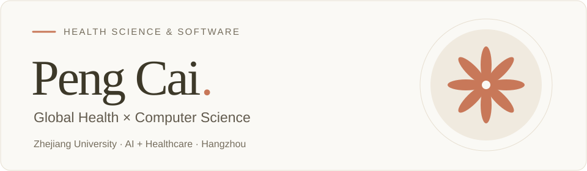
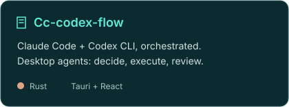
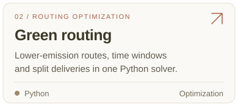
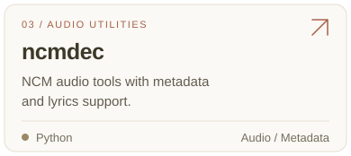
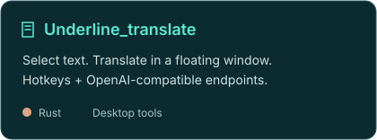

  <picture>
    <source media="(max-width: 640px)" srcset="./assets/header-mobile.svg"/>
    
  </picture>
  
<strong>AI + Healthcare</strong> · Medical data intelligence Building with Rust · Python · TypeScript

## About

- **MSc, Big Data Health Science** — Zhejiang University · 2026–2029
- **AI + Healthcare** @ 浙江大学数智健康研究院 · Hangzhou
- **BSc, Global Health** (minor in CS) — Wuhan University · 2022–2026
- Born in 2004 · Exploring multi-agent systems, desktop tools & medical data

## Selected projects

  
  
  
  

Project links in plain text

[Cc-codex-flow](https://github.com/CPbianma/Cc-codex-flow) · [Green routing](https://github.com/CPbianma/green-vrptw-split-delivery) · [ncmdec](https://github.com/CPbianma/ncmdec) · [Underline_translate](https://github.com/CPbianma/Underline_translate)

## Toolbox

  
<code>Rust</code> <code>Python</code> <code>TypeScript</code> <code>Java</code> <code>React</code> <code>Tauri</code> <code>Git</code> <code>GitHub</code>

## Elsewhere on GitHub

  
<a href="https://github.com/CPbianma?tab=repositories">All repositories</a> · <a href="https://github.com/CPbianma?tab=stars">Starred projects</a> · <a href="https://github.com/CPbianma/zju-learning-course-service">Course monitor · work in progress</a>

<picture>
  <source media="(max-width: 640px)" srcset="./assets/footer-mobile.svg"/>
  
</picture>
