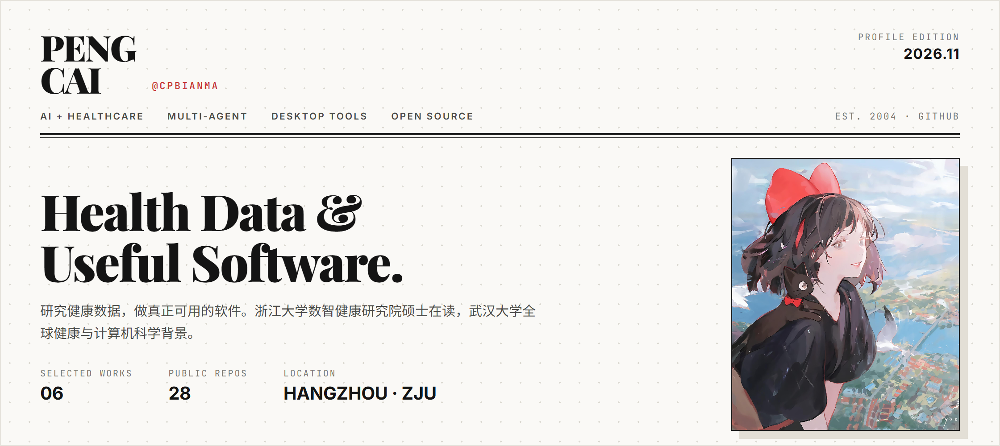
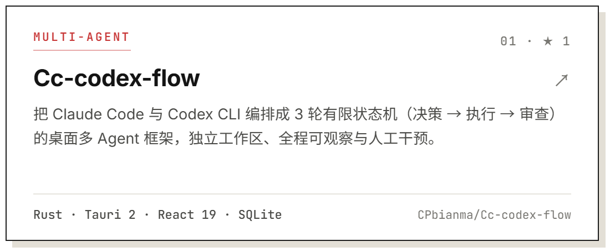
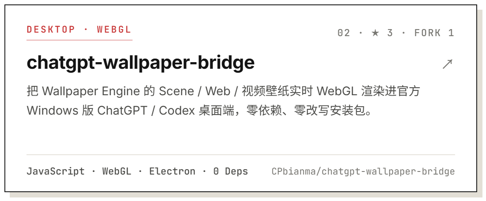
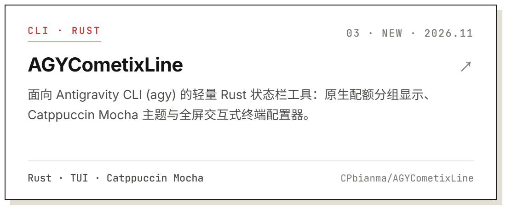
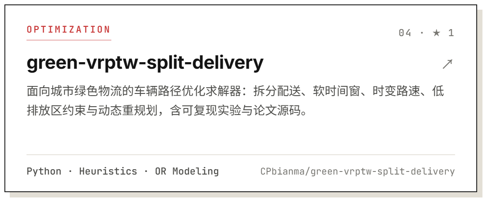
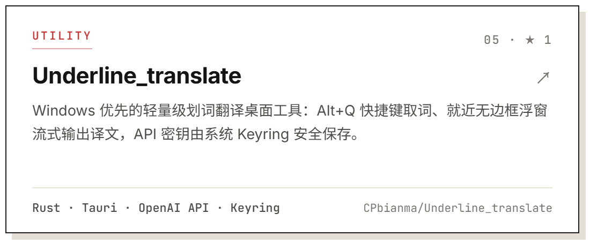
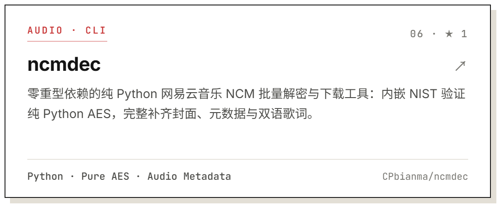
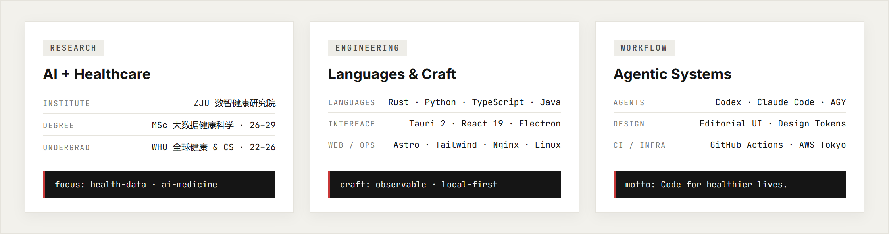

  <picture>
    <source media="(prefers-color-scheme: dark)" srcset="./assets/editorial/hero-cn-dark.png" />
    <source media="(prefers-color-scheme: light)" srcset="./assets/editorial/hero-cn-light.png" />
    
  </picture>

  <strong>中文</strong> &nbsp;·&nbsp;
  <a href="https://github.com/CPbianma/CPbianma/blob/main/README.en.md">English</a> &nbsp;·&nbsp;
  <a href="https://cpbianma.github.io/">个人主页</a> &nbsp;·&nbsp;
  <a href="https://blog.cplearn.codes/">个人博客</a> &nbsp;·&nbsp;
  <a href="https://cplearn.codes/">服务导航</a> &nbsp;·&nbsp;
  <a href="https://github.com/CPbianma?tab=repositories">全部仓库</a> &nbsp;·&nbsp;
  <a href="https://github.com/CPbianma?tab=stars">Stars</a>

  <picture>
    <source media="(prefers-color-scheme: dark)" srcset="./assets/editorial/sec-works-cn-dark.png" />
    <source media="(prefers-color-scheme: light)" srcset="./assets/editorial/sec-works-cn-light.png" />
    
  </picture>

  <a href="https://github.com/CPbianma/Cc-codex-flow"><picture><source media="(prefers-color-scheme: dark)" srcset="./assets/editorial/card-codex-flow-cn-dark.png" /><source media="(prefers-color-scheme: light)" srcset="./assets/editorial/card-codex-flow-cn-light.png" /></picture></a>
  <a href="https://github.com/CPbianma/chatgpt-wallpaper-bridge"><picture><source media="(prefers-color-scheme: dark)" srcset="./assets/editorial/card-wallpaper-bridge-cn-dark.png" /><source media="(prefers-color-scheme: light)" srcset="./assets/editorial/card-wallpaper-bridge-cn-light.png" /></picture></a>

  <a href="https://github.com/CPbianma/AGYCometixLine"><picture><source media="(prefers-color-scheme: dark)" srcset="./assets/editorial/card-agyline-cn-dark.png" /><source media="(prefers-color-scheme: light)" srcset="./assets/editorial/card-agyline-cn-light.png" /></picture></a>
  <a href="https://github.com/CPbianma/green-vrptw-split-delivery"><picture><source media="(prefers-color-scheme: dark)" srcset="./assets/editorial/card-green-vrptw-cn-dark.png" /><source media="(prefers-color-scheme: light)" srcset="./assets/editorial/card-green-vrptw-cn-light.png" /></picture></a>

  <a href="https://github.com/CPbianma/Underline_translate"><picture><source media="(prefers-color-scheme: dark)" srcset="./assets/editorial/card-underline-translate-cn-dark.png" /><source media="(prefers-color-scheme: light)" srcset="./assets/editorial/card-underline-translate-cn-light.png" /></picture></a>
  <a href="https://github.com/CPbianma/ncmdec"><picture><source media="(prefers-color-scheme: dark)" srcset="./assets/editorial/card-ncmdec-cn-dark.png" /><source media="(prefers-color-scheme: light)" srcset="./assets/editorial/card-ncmdec-cn-light.png" /></picture></a>

  <picture>
    <source media="(prefers-color-scheme: dark)" srcset="./assets/editorial/sec-toolkit-cn-dark.png" />
    <source media="(prefers-color-scheme: light)" srcset="./assets/editorial/sec-toolkit-cn-light.png" />
    
  </picture>

  <picture>
    <source media="(prefers-color-scheme: dark)" srcset="./assets/editorial/toolkit-cn-dark.png" />
    <source media="(prefers-color-scheme: light)" srcset="./assets/editorial/toolkit-cn-light.png" />
    
  </picture>

<strong>更多实验项目与校园工具 / More Projects &amp; Index</strong>

 

| 项目 | 分类 | 技术栈 | 简介 |
|---|---|---|---|
| **[design-archive](https://github.com/CPbianma/design-archive)** | Design System | HTML · CSS Tokens | 可复用的视觉方向、设计变量与中英双语风格规范库 |
| **[CPbianma.github.io](https://github.com/CPbianma/CPbianma.github.io)** | Portfolio | HTML · CSS · JS | 个人独立双语主页，支持明暗切换与项目展示 |
| **[zju-library-booker](https://github.com/CPbianma/zju-library-booker)** | Campus Tool | Electron · React · TS | 浙江大学图书馆非官方桌面端查询与预约预览工具（`★ 1`） |
| **[remotion-video-workspace](https://github.com/CPbianma/remotion-video-workspace)** | Creative | TypeScript · Remotion | 独立多视频项目工作区、可复用模板与一键脚手架 |
| **[douyin-live-grabber](https://github.com/CPbianma/douyin-live-grabber)** | Automation | Python | 抖音直播间小黄车新品/降价/关键词监控与多渠道推送提醒 |
| **[zju-yjsy-course-grabber](https://github.com/CPbianma/zju-yjsy-course-grabber)** | Campus Tool | JavaScript | 浙大研究生教务系统补退选轮询脚本，带冲突检测与面向对象过滤 |
| **[zju-learning-course-service](https://github.com/CPbianma/zju-learning-course-service)** | Service (WIP) | Python | 浙学课记：Windows 私有部署智云课堂监测、任务队列与笔记阅读服务 |

  <picture>
    <source media="(prefers-color-scheme: dark)" srcset="./assets/editorial/footer-dark.png" />
    <source media="(prefers-color-scheme: light)" srcset="./assets/editorial/footer-light.png" />
    
  </picture>

